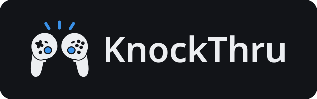
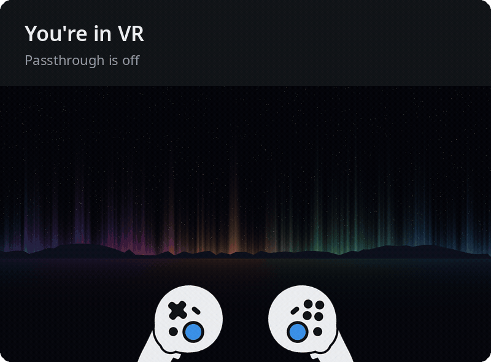
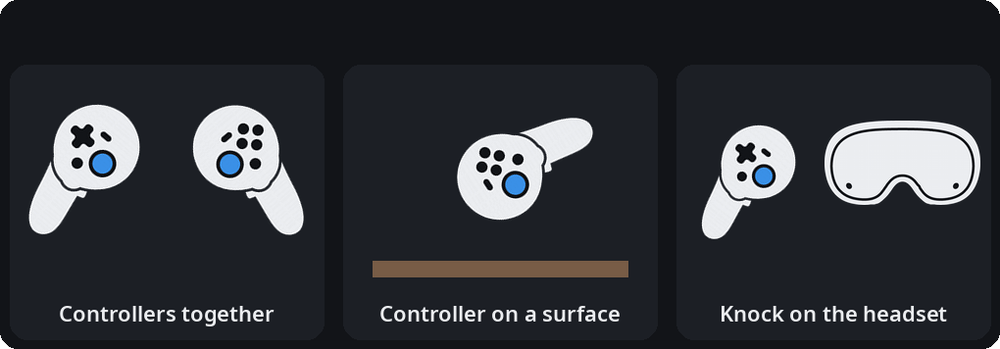
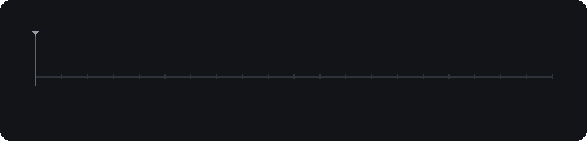
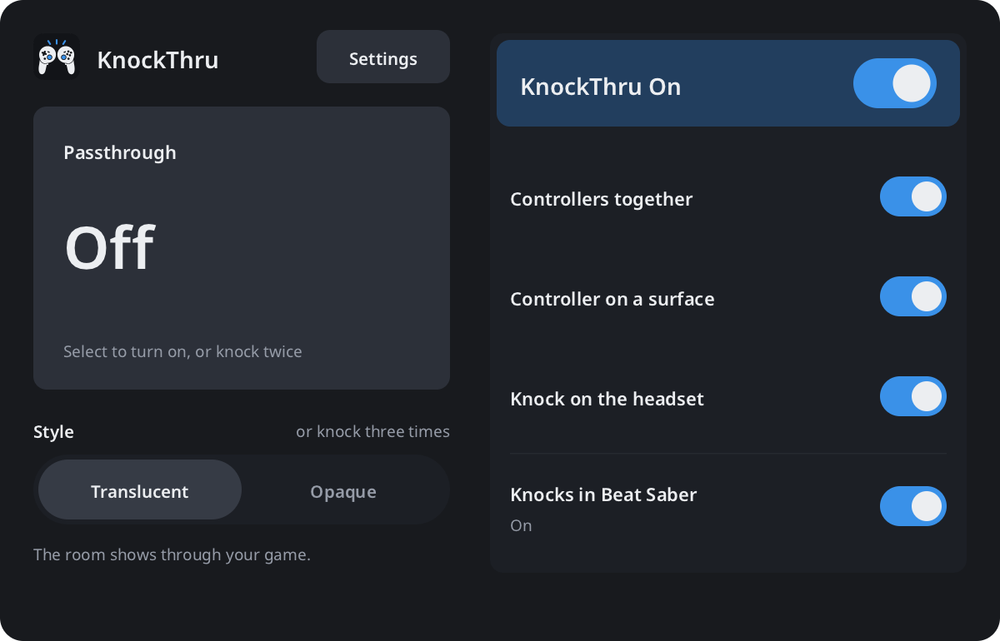
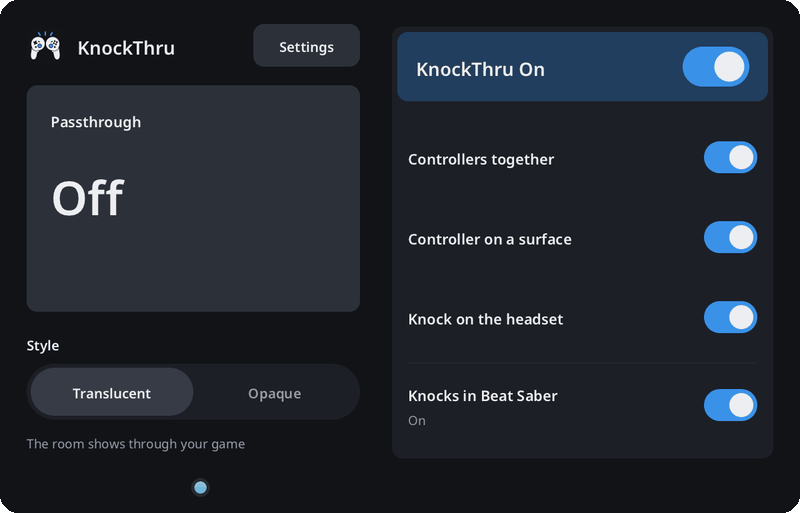
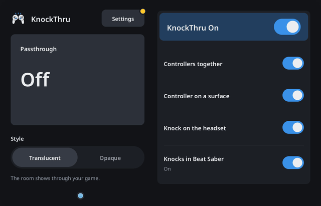
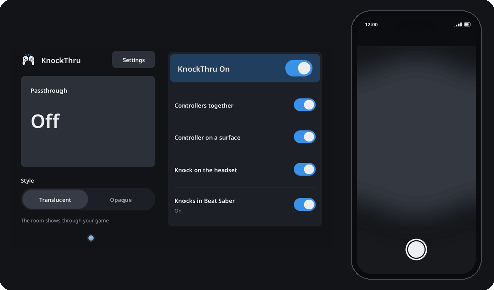

# 

Knock twice to turn on passthrough and see your room without taking off your Steam Frame. Knock three times to switch between seeing the room through your game and seeing only the room.



## Install

1. On the Frame, turn on **Developer Mode**. Then turn on **CEF Remote Debugging** in the Developer settings. KnockThru needs it to press Steam's passthrough button, Room View, for you.
2. Click this button:

   [](https://framedropvr.com/install?manifest=https%3A%2F%2Fgithub.com%2FVioletTides%2FKnockThru%2Freleases%2Flatest%2Fdownload%2Fknockthru.framedrop.json)

3. Open **Library → Non-Steam** and launch **KnockThru** once.

<details>
<summary>No PC? Install from the Frame itself</summary>

1. Do step 1 above.
2. On the Steam bar, open **Konsole**. Developer Mode adds it there.
3. Run this:

   ```sh
   curl -fsSL https://github.com/VioletTides/KnockThru/releases/latest/download/install.sh | sh
   ```

The script downloads the latest release and checks its SHA-256. It unpacks the release to `~/KnockThru`, adds KnockThru to your Steam library, and starts it. Run it again to reinstall. If SteamVR does not answer, go back to Gaming mode and launch KnockThru once from **Library → Non-Steam**.

</details>

<details>
<summary>Install with Frameloader</summary>

[Frameloader](https://www.frameloader.com) runs on macOS, Windows, and Linux.

1. Do step 1 above.
2. Pair Frameloader with the Frame, as its README describes.
3. Drop the Linux ARM64 ZIP from the releases page onto Frameloader.
4. Change **Library ID** to `KnockThru`, so a later reinstall replaces this copy. Then select **Install to Frame**.

Frameloader starts KnockThru, which registers with SteamVR and turns on autostart.

</details>

From now on KnockThru starts with SteamVR and runs in the background. The first time you open the KnockThru tab in the SteamVR dashboard, a short tour starts. It helps you pick your knocks, calibrate them, and try a double and a triple knock.

To pause knocks, turn off the **KnockThru On** switch at the top of the [dashboard tab](#the-dashboard-tab). To clear your settings and calibration, use **Factory reset** in Settings. To remove KnockThru, run `<install folder>/knockthru --uninstall --purge` in Konsole or over SSH, then delete the install folder. `--purge` also deletes your settings and calibration. Leave it out to keep them in `~/.config/knockthru`.

## How to knock

Any of these three knocks works. Use the same kind for every knock in a set.



A surface knock also works on your leg. Keep the controller where the headset cameras can see it, because knocks out of view get missed more often.

Pause for a moment, then knock at a steady pace. After your last knock, KnockThru waits a moment in case another one follows.



| You knock | What happens | You feel |
| --- | --- | --- |
| Twice | Passthrough turns on or off | One buzz |
| Three times | The style switches between translucent and opaque. If passthrough is off, it stays off and opens in the new style next time | Two buzzes |
| Four or more times, or mixed kinds | Nothing | Nothing |

You also hear a click. Steam clicks when passthrough turns on or off, and KnockThru clicks when the style switches. To turn off KnockThru's click, use **Sounds** in Settings.

Three buzzes mean something went wrong. See [Something not working?](#something-not-working) below.

## The dashboard tab

Open the SteamVR dashboard and pick the **KnockThru** tab to do everything by hand.



- **Passthrough** and **Style**: switch passthrough and its style by hand. **Translucent** shows the room through your game. **Opaque** shows only the room.
- **KnockThru On**: turns knocking off for a while without quitting the app.
- **Controllers together**, **Controller on a surface**, **Knock on the headset**: pick which knock kinds count.
- **Knocks in** your game: turns knocks off only in the game you're playing, for games where you knock things on purpose.
- **Settings**: updates, Calibrate, Sounds, Classic bar icon, Guided tour, Report, and Factory reset.

## Calibrate

If soft knocks get missed, calibrate that knock kind. Open **Settings** in the KnockThru tab and press **Calibrate**.



1. Pick the knock kind to calibrate.
2. Read how to knock it, then press **Start**.
3. Wait for the ring, then knock once. Do it 10 times. One buzz means a knock counted.
4. Knock twice to try the new calibration. If it works, press **Save**.

## Updates

KnockThru checks GitHub for a new release once a day. When one is out, a yellow dot shows on the **Settings** button.



1. Open **Settings** and press **Install**. The button fills as the release downloads and gets checked.
2. Press **Restart**. KnockThru starts the new version.
3. A card says which version you have now. Press **OK**.

If the install or the restart fails, a card gives the reason. To check right away, press **Check for updates** in Settings. Updating through FrameDrop works too.

## Something not working?

- **Soft knocks don't register.** [Calibrate](#calibrate) that knock kind.
- **Three buzzes after a knock.** KnockThru heard you but could not change passthrough. One cause is that **CEF Remote Debugging** is off. Turn it back on in the Frame's Developer settings. The dashboard tab also shows the reason.
- **Knocks do nothing in one game.** Check the **Knocks in** switch for that game in the dashboard tab.
- **Passthrough says "A Steam update moved the Room View button".** KnockThru presses that button through Steam's own dashboard, so a Steam update can break it. Install the KnockThru [update](#updates) that fixes it. If none is out yet, report it.
- **Anything else.** [Report it](#report-a-problem) from the headset.

## Report a problem

You can send a bug report from the headset with your phone. You need a GitHub account.



1. Open **Settings** in the KnockThru tab and press **Report**.
2. Take off the headset. Hold your phone up to either lens and scan the QR code. Your phone must be on the same Wi-Fi as the Frame.
3. On your phone, tap **Copy report and open GitHub**.
4. Paste the report, say what went wrong, and tap **Create**.

The new issue already has your KnockThru and SteamVR versions filled in.

If knocks get missed or do the wrong thing, press **Record knocks** first. Then knock the way that goes wrong for 20 s. Your phone then gets one file, `knockthru-report.zip`, with the report and the recording, to attach to the issue.

If you have no phone, or the Frame is offline, press **Save to headset**. The report goes to `knockthru-report.txt` in your home folder, for you to attach to an issue.

## For tinkerers

These need a terminal on the Frame: Konsole, or SSH from a PC.

<details>
<summary>Settings file</summary>

Put your settings in `~/.config/knockthru/config.json`. This file survives updates, and KnockThru reloads it within 2 s of a change. The dashboard tab writes to this file too.

```json
{
  "knock_types": ["together", "surface"],
  "blocked_apps": ["steam.app.620980"]
}
```

- `knock_types`: which knock kinds count. The default is all three.
- `blocked_apps`: SteamVR app keys where knocks do nothing. Run `knockthru --current-app` while a game runs to get its key.
- `debug_port`: the CEF Remote Debugging port. The default is 8080.
- `classic_bar_icon`: `true` shows the dashboard bar icon in the logo colors. The default `false` shows the logo in grey, and white on hover, like Steam's own icons.
- `check_updates`: `false` stops the daily update check. By default, KnockThru asks GitHub for the latest release once a day, a minute after it starts. **Check for updates** in Settings works either way.
- `sounds`: `false` silences the click. By default, KnockThru plays SteamVR's dashboard click on a triple knock and on panel buttons. Steam already clicks when a double knock changes passthrough.
- `paused`: `true` while the **KnockThru On** switch is off. Knocks do nothing then.
- `detector`: overrides for the knock detector's settings, such as `confirmed_peak` or `max_gap_s`. The comments in `src/knock_detector.hpp` describe each one. Calibration sets the peaks for you.
- `tour_done`: `true` once the first-run tour is finished or skipped. Set it to `false` to see the tour the next time you open the KnockThru tab. Settings also has a Replay button.

</details>

<details>
<summary>Calibrate from a terminal</summary>

```sh
<install folder>/knockthru --calibrate together
```

Use `together`, `surface`, or `headset`. Knock 10 times within 90 s. Each knock KnockThru hears gives one buzz. The new threshold goes to `~/.config/knockthru/calibration.json`, and the running app picks it up within 2 s.

</details>

<details>
<summary>Commands</summary>

Run these on the Frame, in Konsole or over SSH.

| Command | What it does |
| --- | --- |
| `knockthru` or `--install` | Register with SteamVR, turn on autostart, and start |
| `--uninstall` | Stop and remove from SteamVR. Keeps `~/.config/knockthru` |
| `--uninstall --purge` | Also delete `~/.config/knockthru`, SteamVR's autostart file for KnockThru, and the report files in your home folder |
| `--status` | Show registration, the running process, and passthrough state |
| `--update` | Install the latest GitHub release over this one and restart |
| `--report` | Write `~/knockthru-report.txt` with versions, settings, and logs, to attach to an issue |
| `--toggle`, `--style` | Turn passthrough on or off, or switch its style, once |
| `--detect` | Print knocks live without acting on them |

The log is `~/.config/knockthru/application.log`.

</details>

<details>
<summary>Manual installation</summary>

Copy the Linux ARM64 ZIP from the releases page to the Frame, then run:

```sh
unzip -oq knockthru-1.0.2-linux-arm64.zip -d ~/KnockThru
~/KnockThru/knockthru --install
```

</details>

<details>
<summary>Build</summary>

Host build and detector tests (any Linux with CMake and a C++17 compiler):

```sh
cmake -S . -B build
cmake --build build
ctest --test-dir build
```

Steam Frame build (needs Zig 0.16.0) and release ZIP (needs Node.js):

```sh
scripts/build-arm64.sh
node scripts/package.mjs --build-dir build-arm64 --version 1.0.2
```

README images (needs Pillow, numpy, ffmpeg, and Chromium, after the host build):

```sh
python3 scripts/readme_media.py
```

The controller and headset sprites in `images/cad/` come from Valve's CAD files. To render them again, download the STEP files from [Valve's Steam Frame repository](https://gitlab.steamos.cloud/SteamHardware/SteamFrame) into one folder. Then run this, which needs cadquery and opencv-python and takes about 12 minutes:

```sh
python3 scripts/cad_sprites.py <CAD folder>
```

To replay the knock recording from a bug report, unzip the report and run this:

```sh
build/bin/detector_test knockthru-knocks.csv.gz
```

[`docs/`](docs/README.md) explains how knock detection and calibration work, how they were tuned, and how the app fits together.

</details>

## Credits

- [KominoVR/frame-passthrough-shortcuts](https://github.com/KominoVR/frame-passthrough-shortcuts) (MIT): app scaffolding, style switch, and packaging.
- [toorux/steam-frame-passthrough-toggle](https://github.com/toorux/steam-frame-passthrough-toggle) (MIT): the Room View button click through the debug port.

- The controller and headset drawings are rendered from [Valve's Steam Frame CAD files](https://gitlab.steamos.cloud/SteamHardware/SteamFrame) (CC BY-NC-SA 4.0). Those images keep that license. See [THIRD_PARTY_NOTICES.md](THIRD_PARTY_NOTICES.md). KnockThru is not associated with or endorsed by Valve.

[MIT licensed](LICENSE).

Developed with help from coding agents.
