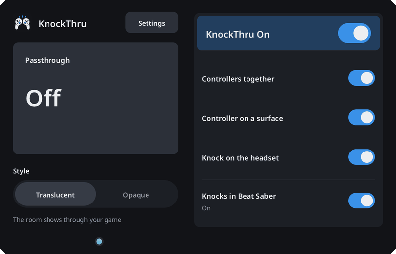

# How calibration works

Everyone knocks a little differently. Some people knock hard, and some barely touch. The default thresholds catch most knocks, but soft ones can slip under them. Calibration measures 10 of your knocks and fits the thresholds for that kind of knock to you.

## The walkthrough

1. **Pick** the kind of knock to calibrate: together, surface, or headset.
2. **Learn** how to knock it, then press Start.
3. **Record** 10 single knocks within 90 s. A ring fills before each one, and one buzz means the knock counted.
4. **Try** the new thresholds by knocking twice. Save only unlocks once the try works, and the try never switches passthrough.

The first 3 s after Start don't count, so your hand coming down from the Start button isn't taken for a knock. After each counted knock, the next one waits 1 s, while the ring fills.

You can also calibrate from a terminal on the Frame with `knockthru --calibrate together` (or `surface`, or `headset`). The result goes to `~/.config/knockthru/calibration.json`.

## How it hears soft knocks

While it records, calibration lowers the spike thresholds a long way: surface knocks need 30 m/s² instead of 60, and together and headset knocks need 12 instead of 40. That low, almost any movement looks like a knock, so calibration is much pickier about which spikes it counts.

Spikes less than 0.25 s apart are treated as one burst, and KnockThru judges the burst by its fastest knock. A burst counts when:

1. Nothing else happened in the 0.6 s before it. Waving makes clusters of spikes, and people pause between calibration knocks.
2. The controller came in at 0.25 m/s or faster. This approach speed is the controller's fastest speed in the 100 ms before the spike.
3. For surface knocks, the controller was nearly still beforehand, averaging under 0.6 m/s from 0.6 s to 0.15 s before the knock. Starting a swing from rest can spike before the real knock lands, and this check skips that early spike.
4. The spike reaches the floor for its kind (see below). A knock under the floor could never trigger anything, so the walkthrough says "too light" instead of counting it.

Together and headset knocks skip the stillness check, because a headset knock starts with your arm rising.

## Why approach speed matters

The spike alone is a rough measure of how hard you knocked. The spike divides a change in speed by the time between two controller updates, and that time wobbles between 2 and 7 ms, so the same knock can give quite different spikes. How fast the controller came in is much steadier, and slow hand movements fall well under it. That's why calibration sets an approach threshold as well as a spike threshold.

## Turning 10 knocks into thresholds

Each kind of knock gets two thresholds:

- **Spike threshold:** 60 percent of your weakest recorded spike. It never goes below the floor for that kind, and never above 150 m/s².
- **Approach threshold:** 55 percent of your second slowest approach. Using the second slowest means one odd knock can't drag it down.

The floors stop calibration from setting a threshold so low that everyday movement gets through:

| Kind | Floor | What goes wrong below it |
| --- | --- | --- |
| Surface | 50 m/s² | Real surface doubles split apart |
| Together | 30 m/s² | Fitting the controller straps can bump them together into a double |
| Headset | 20 m/s² | Soft rebounds count as an extra knock and turn doubles into triples |

If a saved threshold is below its floor, KnockThru uses the floor.

Only one knock in a set has to reach the approach threshold. The second knock of a quick double starts from the rebound of the first, so it often comes in slow.
