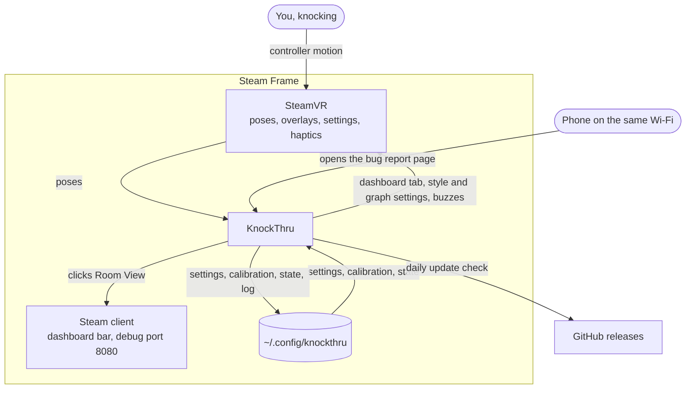
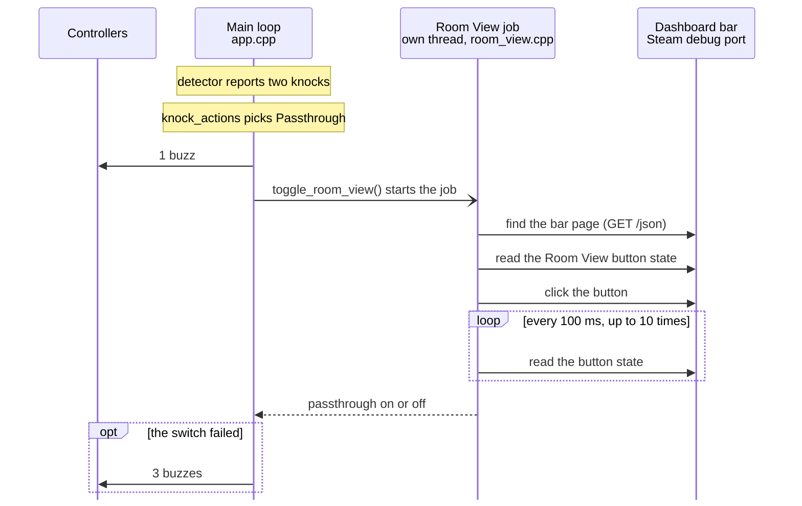

# How the app fits together

KnockThru is a program that runs on the Steam Frame, not on a PC, and shows up as a tab on the SteamVR dashboard.

## From a knock to passthrough

1. **Reading motion:** KnockThru reads the headset and controller positions from SteamVR about once a millisecond. Every knock starts with a controller moving, so it reads less often while nothing moves: 20 times a second while no controller is tracked, such as in standby, and 100 times a second while both controllers are still. The moment a controller moves, it goes back to full speed.
2. **Finding knocks:** the knock detector looks through that motion for knocks. [How knock detection works](knock-detection.md) explains how.
3. **Acting:** by default, knocking twice turns passthrough on or off, and knocking thrice switches its style. **Knock actions** in Settings can change that, or show and hide SteamVR's performance graph instead. Both controllers buzz once after knocking twice and twice after knocking thrice. Three buzzes mean something failed.

With the default actions, this is what happens after you knock twice:

Knocks do nothing while KnockThru is paused, or in a game where you turned knocks off.

## Switching passthrough

To turn passthrough on or off, KnockThru presses the Room View button on the SteamVR dashboard bar. The bar is a web page inside the Steam client, and CEF Remote Debugging (port 8080 on the Frame) lets KnockThru reach it. That's why CEF Remote Debugging has to be on in the Frame's Developer settings. After each press, KnockThru checks that passthrough really changed. This approach comes from [toorux/steam-frame-passthrough-toggle](https://github.com/toorux/steam-frame-passthrough-toggle).

The style and the performance graph are ordinary SteamVR settings, so KnockThru changes them directly. The style is `camera.roomViewStyle`, 3 for translucent and 4 for opaque, values that come from [KominoVR/frame-passthrough-shortcuts](https://github.com/KominoVR/frame-passthrough-shortcuts). The performance graph is `perfcheck.perfGraphInHMD`, the same as **Show Perf Overlay in VR** in Steam's Quick Access menu, and it also shows over games streamed from a PC.

If a Steam update moves the Room View button, KnockThru can't find it until a KnockThru update fixes that. The dashboard tab then says "A Steam update moved the Room View button. Update KnockThru in Settings."

## The dashboard tab

KnockThru draws its own dashboard tab. It draws the text and shapes into an image and hands that image to SteamVR to show. The tab holds the switches, Settings, the calibration walkthrough, and the first-run tour.

## Two copies of one program

The install folder has `knockthru` and `knockthru-ctl`, and they're the same file. SteamVR tells apps apart by where their program lives. SteamVR starts `knockthru` as the app, and commands like `--uninstall` run through `knockthru-ctl`, so SteamVR never mistakes a command for a second copy of the app.

## Settings and files

| File | What it holds |
| --- | --- |
| `<install folder>/config.json` | The defaults that ship with each release |
| `~/.config/knockthru/config.json` | Your settings. The dashboard tab writes here too |
| `~/.config/knockthru/calibration.json` | Your calibrated thresholds, one entry per kind of knock |
| `~/.config/knockthru/state.json` | What KnockThru remembers between runs, like the last update check |
| `~/.config/knockthru/application.log` | The log |

KnockThru notices changed settings within 2 s and picks them up. Your files live outside the install folder, so updates never touch them. [Settings](settings.md) lists every key.

## Updates

Once a day, KnockThru asks GitHub about the latest release. Each release lists its ZIP and the ZIP's SHA-256 checksum. To install an update, KnockThru:

1. Downloads the ZIP over HTTPS.
2. Checks the ZIP's SHA-256, and stops if it doesn't match.
3. Unpacks it and checks that `knockthru-ctl` is an identical copy of `knockthru`.
4. Copies each new file in beside the old one under a temporary name, then swaps it into place, so a failed copy leaves the old version working.
5. Restarts into the new version.

After the restart, the new version reads `whats-new.md` from the install folder and picks the versions newer than the one it replaced. If only one version has notes and they fit, the update card lists them. Otherwise the card gets a **What's new** button that opens a paged list. `whats_new_test` fails the build if a note needs more than two lines, or if the current version has no notes.

The release workflow puts the same notes at the top of the GitHub release, above the generated list of pull requests.

## Bug reports

**Report** in Settings writes a report with versions, SteamVR state, settings, and the end of the log. To get it to your phone, it shows a QR code that links to a small web page the headset serves on your Wi-Fi. The link has a random token in it, and the page stops after 15 minutes. On your phone, the page copies the report and opens a GitHub issue with the details filled in.

If knocks are the problem, **Record knocks** adds 20 s of motion to the report. [The test recordings](test-recordings.md) shows how to replay it.
