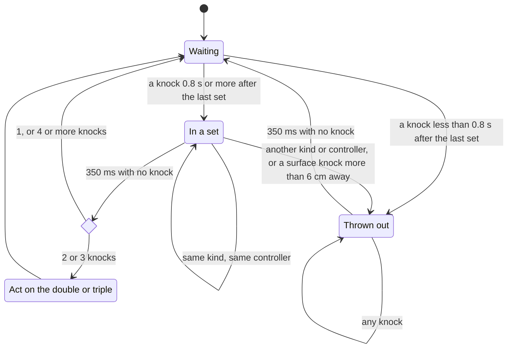

# How knock detection works

KnockThru watches how your controllers and headset move, and looks for the short, sharp stop that a knock makes. This page explains what it looks for and why. The code is in `src/knock_detector.cpp`, and the thresholds are in `DetectorConfig` in `src/knock_detector.hpp`.

## What KnockThru can see

KnockThru can't read the controllers' accelerometers. The Frame has no `/dev/hidraw` devices that would expose them. What SteamVR does give every app is each device's position and velocity.

KnockThru reads those about once a millisecond. The headset reports a new velocity 1000 times a second, and each controller about 230 times a second. The thresholds depend on that rate. Replaying the recordings at 500 Hz (`KNOCKTHRU_TEST_DECIMATE=2`) misses together, surface, and headset doubles and finds 2 false actions in `noise`.

A knock shows up as a sudden jump in velocity. KnockThru divides the change between two updates by the time between them. That gives an acceleration in m/s², and these pages call it the **spike**.

## Why a big spike isn't enough

The obvious rule is "a hard spike is a knock". It doesn't work. In the `play` recording, ordinary movement spiked at 696 m/s². The hardest knock in any of the knock recordings spiked at 552.

What separates a knock from a swing is what happens right after. When you knock, the controller stops dead. When you swing, it keeps going. In the first recordings, the controller moved at a median of 0.1 to 0.2 m/s 30 ms after a knock, and at 1.6 to 1.7 m/s 30 ms after a swing spike.

So a spike counts as a knock only when all of these hold:

1. It's the biggest spike within 3 updates either side.
2. It's stronger than the threshold for its kind of knock (see below).
3. 30 ms later, the controller moves slower than 0.4 m/s. Surface knocks get 0.55 m/s, because a hard knock on a table bounces back.
4. 30 ms earlier, the controller moved slower than 1.8 m/s. Surface knocks get 2.2 m/s, because knocks on a leg come in fast.

KnockThru judges each spike about 50 ms after it happens, so the "30 ms later" part has already arrived.

## Three kinds of knock


KnockThru works out the kind by checking what the other devices did at the same moment:

- **Headset:** the headset spiked above 25 m/s² within 30 ms of the controller
- **Together:** the other controller spiked above 20 m/s² within 40 ms, and the two controllers were less than 15 cm apart
- **Surface:** anything else, like a desk, a table, or your leg

A together or headset knock has a second device backing it up. So the controller's spike only needs to reach 40 m/s². A surface knock has no witness, so it needs 60 m/s².

Head shaking moved the headset at up to 22 m/s², under the 25 needed for a headset knock. A knock on the headset moved it at 40 to 215 m/s².

## From knocks to a double or a triple

One knock does nothing. KnockThru groups knocks into a set, and acts on sets of 2 or 3.

- **Bounces merge:** spikes less than 80 ms apart count as one knock
- **Knocks in a set need a small gap:** a surface knock less than 150 ms after the last one counts as a bounce and gets ignored, because a table bounce can land 120 ms after a real knock. Together and headset knocks only need 105 ms, so fast doubles still count.
- **A set ends after 350 ms of quiet:** then 2 knocks are a double and 3 are a triple. By default, a double turns passthrough on or off and a triple switches the style. `knock_actions` in [Settings](settings.md) changes that. 4 or more knocks do nothing, so steady clapping never counts.
- **A set must match:** every knock in it must be the same kind, from the same controller. Surface knocks must also land within 6 cm of each other.
- **A set must start from stillness:** it has to begin at least 0.8 s after the last set ended

The last two rules are about clapping runs. Without them, two weak claps right after a clapping run looked like a double. With them, a set that mixes anything is thrown out whole, and the next set has to wait.

This is how the detector moves through a set (`src/knock_detector.cpp`):



A set also does nothing if none of its knocks approached fast enough ([How calibration works](calibration.md)), or if `knock_types` turns its kind off.

The 350 ms wait plus the 50 ms judging delay is why passthrough switches about 0.4 s after your last knock.

## How the rules were found

After the first prototype, each new rule came from a recording that the older rules got wrong.

### The first prototype

The first five recordings were 45 s each, made on 2026-10-14: knocks of each kind, normal play, and clapping and waving (`noise`). A Python prototype with the spike, the stop, and the 80 ms merge found 18 to 20 doubles in each knock file and none in `play` or `noise`.

The C++ version found one false double at 18.9 s in `noise`. Two weak claps, 500 ms after a 3 s clapping run, formed a pair. The "a set must match" and "start from stillness" rules fixed it.

### Live sessions

Running the detector live with `knockthru --detect` turned up three problems:

- A 1 s cooldown after each action swallowed the first knock of the next set. It's gone. The 0.8 s stillness rule already keeps sets apart.
- Weak third knocks peaked at 42 to 48 m/s², under the 60 that every knock needed then. Together and headset knocks now need only 40.
- Real gaps between knocks ran 170 to 290 ms. A 450 ms window let two weak spikes 357 ms apart in `play` form a false double. The window is now 350 ms.

### Fast doubles

The `fast` recording holds quick together doubles, 89 to 168 ms apart. The 150 ms gap dropped half of them. Rebounds landed 83 to 99 ms after a real knock, so together and headset knocks got a 105 ms gap instead.

### Leg knocks

Knocks on a leg come in faster than knocks on a desk. Most right-hand leg knocks moved faster than 1.8 m/s just before the spike, so the detector took them for arm swings. Surface knocks got their own limit of 2.2 m/s. Together and headset knocks kept 1.8 m/s, because at 2.2 a together calibration counted a knock in the `noise` recording.

Two knocks on a leg also land further apart than two on a desk. In a run of about 40 leg doubles, 7 pairs landed 3.5 to 8.3 cm apart, and the old 3 cm limit dropped them. At 6 cm, 25 doubles count instead of 20.

### Strap fitting

Fitting the controller straps in Into the Radius 2 bumped the controllers together 19 times in 5 s. The default together threshold of 40 m/s² ignores them. A calibration that set it to 20 did not, and the first two bumps turned passthrough on. Calibration now never sets the together threshold below 30. [How calibration works](calibration.md) has the details.

## Changing the thresholds

Every threshold on this page can be overridden in `~/.config/knockthru/config.json`, under `detector`. The names match `DetectorConfig`. For example, this makes surface knocks need a harder spike:

```json
{
  "detector": { "controller_peak": 80 }
}
```

Before you change a default in the code, run the tests. [The test recordings](test-recordings.md) explains what they check and how to try a value against every recording.

## Background

Accelerometer chips with built-in tap detection use the same ideas: a threshold, a short pulse, a quiet time, and a window for the second tap. [ST design tip DT0101](https://www.st.com/resource/en/design_tip/dt0101-setting-up-singletap-and-doubletap-recognition-with-sts-mems-accelerometers-stmicroelectronics.pdf) and [NXP AN3919](https://www.nxp.com/docs/en/application-note/AN3919.pdf) describe them.
