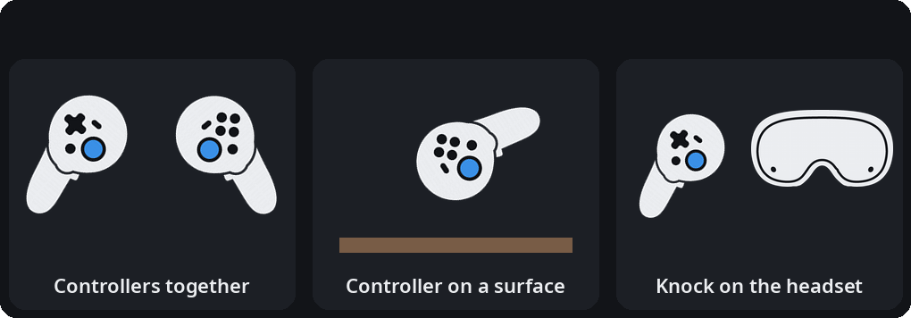
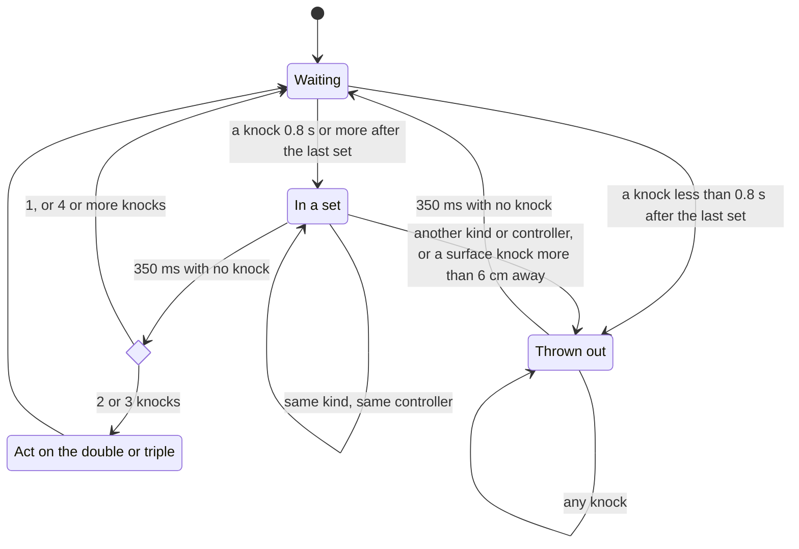

# How knock detection works

KnockThru watches how your controllers and headset move, and looks for the short, sharp stop that a knock makes.

## What KnockThru can see

SteamVR tells apps where each device is and how fast it's moving, and KnockThru checks about once a millisecond. Apps can't read the controllers' accelerometers. When a device's speed jumps suddenly, KnockThru works out how sharp the jump was, in m/s². These pages call that a **spike**.

## Why a big spike isn't enough

Swinging your arm in a game can spike harder than any real knock, so a hard spike alone proves nothing. The difference shows a moment later: a controller that knocked has stopped, and one that swung is still moving. KnockThru counts a spike as a knock only when:

1. It's the biggest spike among the few updates around it.
2. It's strong enough for its kind of knock (see below).
3. A moment later, the controller has nearly stopped: under 0.4 m/s, or 0.55 m/s for a knock on a surface, since a hard knock on a table bounces back a little.
4. Just before, the controller was moving under 1.8 m/s, or 2.2 m/s for a surface knock, since knocks on your leg come in fast.

To see what happens after each spike, KnockThru waits about 50 ms before it decides.

## Three kinds of knock



KnockThru tells the kinds apart by what the other devices did at the same moment:

- If the headset jolted too, it's a **headset** knock.
- If the other controller jolted too, and the two were within 15 cm of each other, it's a **together** knock.
- Anything else is a **surface** knock, whether that's a desk, a table, or your leg.

A together or headset knock has a second device backing it up, so its spike only needs to reach 40 m/s². A surface knock has nothing to confirm it, so it needs 60 m/s². Shaking your head doesn't jolt the headset enough to count.

## From knocks to a double or a triple

One knock on its own does nothing. KnockThru gathers knocks into a set, and when the set ends, it acts on 2 or 3 knocks.

- Spikes less than 80 ms apart count as one knock, so a rattle or a bounce doesn't count twice.
- Each knock has to come a little after the last one: 150 ms for surface knocks, because a table bounce can land 120 ms after a real knock, and 105 ms for together and headset knocks, so quick doubles still count.
- The set ends after 350 ms with no knock. Twice turns passthrough on or off, and thrice switches the style, unless you've changed that in [Settings](settings.md). Four or more knocks do nothing, so steady clapping never counts.
- Every knock in a set has to be the same kind, from the same controller. Surface knocks also have to land within 6 cm of each other.
- A set has to start at least 0.8 s after the last one ended.

The last two rules stop clapping from counting. A set that mixes kinds or controllers is thrown out whole, and the next set can't start for 0.8 s.

The same rules as a diagram:



A set also does nothing if you've turned its kind off, or if none of its knocks came in fast enough. [How calibration works](calibration.md) explains that second check.

The 350 ms wait, plus the 50 ms it takes to judge the last knock, is why passthrough switches about 0.4 s after you stop knocking.

## Changing the thresholds

You can change any number on this page in `~/.config/knockthru/config.json`, under `detector`. For example, this makes surface knocks need a harder spike:

```json
{
  "detector": { "controller_peak": 80 }
}
```

[Settings](settings.md) explains where to find every name. If knocks get missed, try [calibrating](../README.md#calibrate) first, because it picks these numbers from your own knocks.

## Background

Accelerometer chips with built-in tap detection work on the same ideas: a threshold, a short pulse, a quiet time after it, and a window for the second tap. [ST design tip DT0101](https://www.st.com/resource/en/design_tip/dt0101-setting-up-singletap-and-doubletap-recognition-with-sts-mems-accelerometers-stmicroelectronics.pdf) and [NXP AN3919](https://www.nxp.com/docs/en/application-note/AN3919.pdf) describe how they do it.
